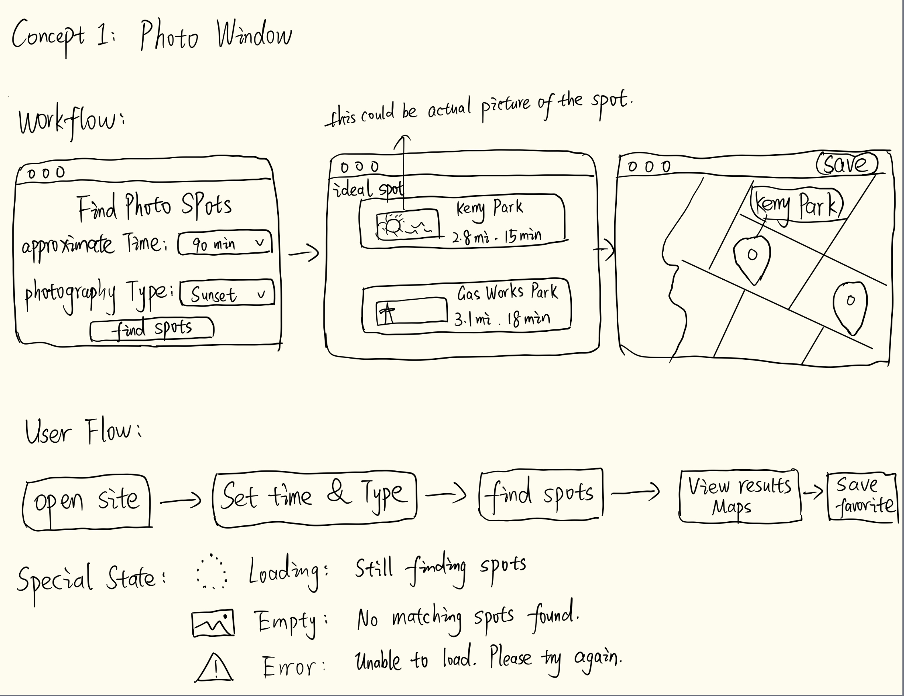
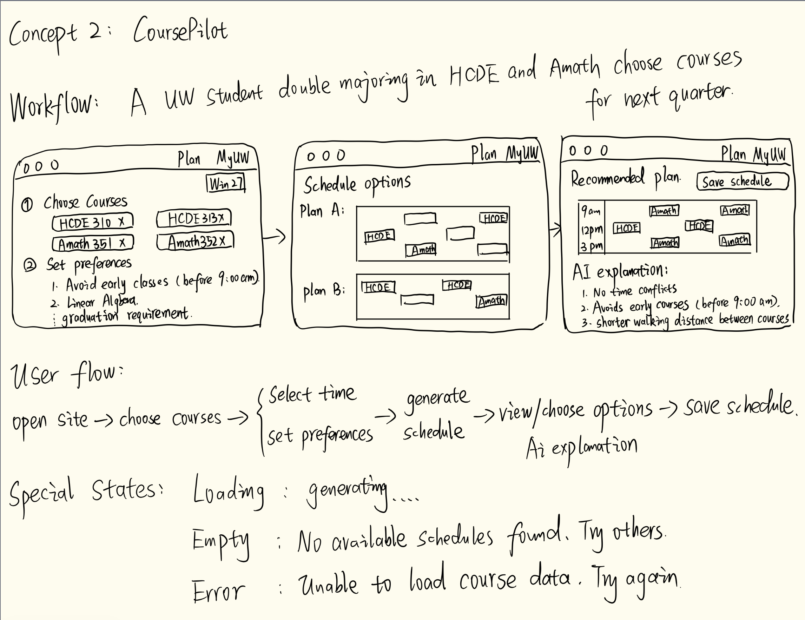
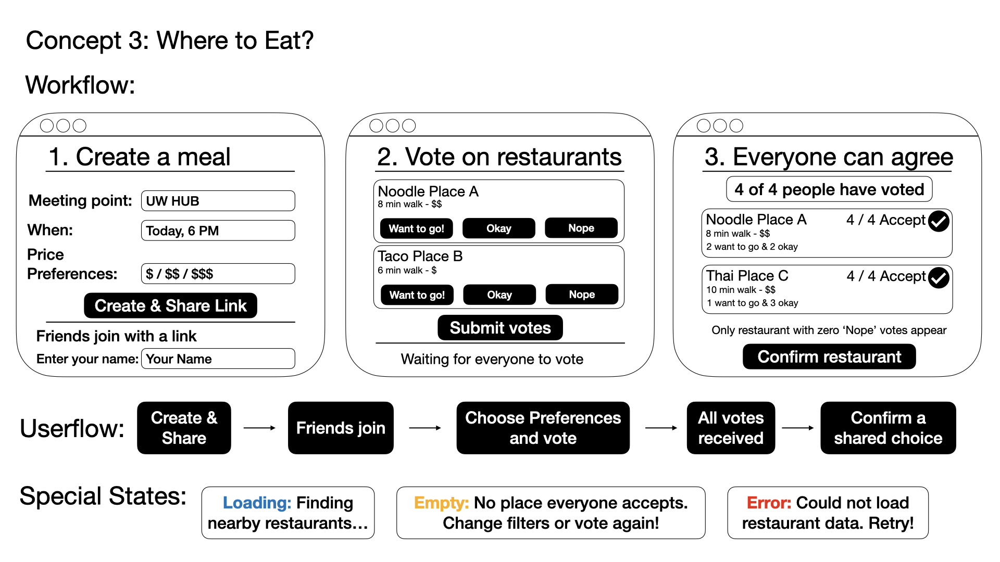

***Concept 1: Photo Window***

Depth Item: Made for a place

**1. What is it?**

Photo Window is a web application designed to help University of Washington students discover nearby photography locations during their free time. Users can enter how much time they have, such as 30, 60, or 90 minutes, and choose their preferred photography type, including sunset, city, nature, or architecture photography. Based on their preferences, the website recommends nearby photography spots and displays useful information such as location, weather conditions, and approximate distance.

**2. Target Audience**

UW Seattle students who enjoy photography but have limited free time between classes.

**3. Value Added**

Students normally need to use multiple websites, such as Google Maps and weather apps, to decide where to take photos. Photo Window combines this information into one website and recommends locations based on three factors:

(1)Available time: How much time the student has before their next class.

(2)Photography interests: Whether they prefer sunset, city, nature, or architecture photography.

(3)Weather conditions: Whether the forecast is suitable for their selected photography type.
Instead of simply showing nearby parks, the website helps students decide which locations are worth visiting during their available time.

Python will compare nearby locations with weather forecasts and the student's available time to recommend suitable photography spots.

**4. Data Sources**

（1）Seattle Parks Viewpoints Dataset: Provides viewpoint locations and geographic coordinates.

Link：https://services.arcgis.com/ZOyb2t4B0UYuYNYH/arcgis/rest/services/Viewpoints/FeatureServer/0

（2）Open-Meteo API: Provides weather forecasts, including rain, cloud cover, and sunset times.

Link: https://open-meteo.com/en/docs

**5. Depth Item**

Made for a place: The website focuses on UW and Seattle and uses a Leaflet map to display recommended photography locations.

**6. Key Moment & Concept Sketch**

A student has 90 minutes before their next class and wants to take sunset photos. They open Photo Window, select their preferences, and receive nearby photography recommendations with weather information on a map.

**7. User Flow**

（1）Open Photo Window.

（2）Select available time and photography type.

（3）Click "Find Spots."

（4）View recommended locations and weather on a map.

（5）Select a location and save it to favorites.

**8. Special States**

Loading: "Finding photo spots..."

Empty: "No matching spots found. Try changing your preferences."

Error: "Unable to load location or weather data. Please try again."

**9. Saved Data**

A JSON file stores users' favorite photography spots between visits.

**10. AI Note**

AI can help develop the Flask website and connect external APIs, but it may not accurately evaluate which locations are best for photography without real user feedback.

***Concept 2: CoursePilot***

Depth Item: AI step with a human check

**1. What Is It?**

CoursePilot is a web application that helps UW students create class schedules based on their desired courses and personal preferences.

Students can enter the courses they want to take and select preferences such as avoiding early morning classes or minimizing walking distances between buildings.

The system checks for scheduling conflicts, generates possible schedule combinations, and uses AI to explain the advantages and disadvantages of each option.

**2. Target Audience**

University of Washington students who need to plan their quarterly class schedules, especially students taking courses from multiple departments.

**3. Value Added**

UW students often need to check course schedules separately and manually compare different sections.

CoursePilot combines course information, campus locations, and personal preferences to help students find suitable schedules more efficiently.

Instead of simply displaying course information, the website recommends possible combinations and explains why certain schedules may better fit students' needs.

**4. Data Sources**

(1) UW Student Web Service (SWS)

Link: https://webservices.washington.edu/sws/

Provides UW course information, including sections, meeting times, and classroom locations.

Python uses this information to identify scheduling conflicts and generate possible schedules.

Some endpoints require authorization, so access must be confirmed before development.

(2) OpenStreetMap Overpass API

Link: https://overpass-api.de/api/interpreter

Provides geographic information about UW campus buildings.

Python uses building coordinates to estimate distances between classes and compare different schedule options.

(3) OpenAI API

Link: https://platform.openai.com/docs/overview

Generates explanations of recommended schedules based on students' preferences.

Students can review the AI recommendations and adjust their preferences before saving a schedule.

How Python Combines the Data:

Python retrieves course information and campus building locations, checks for time conflicts, generates possible schedule combinations, and ranks them based on students' preferences.

The AI API explains the recommendations, while students make the final decision.

**5. Depth Item**

AI explains the advantages and disadvantages of different schedule options. Students review the recommendations, adjust their preferences if needed, and choose which schedule to save.

**6. Key Moment & Concept Sketch**

A UW student double majoring HCDE and Amath wants to take HCDE 310, Amath352, and other courses but prefers to avoid early morning classes and long walks between campus buildings.

The student enters their desired courses and preferences into CoursePilot.

The system generates possible schedules, highlights a recommended option, and explains why it fits the student's preferences.

**7. User Flow**

Open the CoursePilot website.

Enter desired courses.

Select time and schedule preferences.

Click "Generate Schedules."

View and compare recommended schedule options.

Review AI explanations and adjust preferences if necessary.

Save a favorite schedule.

**8. Special States**

Loading: "Generating schedule options..."

Empty: "No available schedules found. Try changing your courses or time preferences."

Error: "Unable to load course data. Please try again later."

**9. Saved Data**

The website uses a JSON file to save students' favorite schedule combinations and preferences so they can return to them later.

**10. AI Note**

AI can help explain schedule recommendations and compare trade-offs, but it may generate inaccurate course information or overlook scheduling constraints, so students must review the results.

***Concept 3: Where to eat?***

Depth Item: Multiplayer

**1. What Is It?**

Where to eat? is a web application that helps a small group of friends choose a nearby restaurant that everyone can accept.

One person creates a meal with a meeting point, time, and price range, then shares a link. Friends join and vote on each restaurant using "Want to go!", "Okay", or "Nope". The final list includes only restaurants that everyone has accepted, with no "Nope" votes.

**2. Target Audience**

Groups of 3–6 UW Seattle students who want to eat together near campus but have different preferences and budgets.

**3. Value Added**

Friends often switch between restaurant listings and a group chat, repeatedly suggesting places and checking whether anyone objects. A popular restaurant may still be unacceptable to one person.

Where to eat? combines nearby restaurant information, estimated walking times, and individual votes to find options the whole group accepts. Restaurant searches provide information about places, while a basic group poll requires someone to collect that information and interpret the votes manually.

Python will combine the external data, apply the group's filters, and identify restaurants with unanimous acceptance. If several restaurants qualify, those with more "Want to go!" votes appear first, and the organizer confirms one.

**4. Data Sources**

(1) Google Places API (New): Nearby Search

Link: https://developers.google.com/maps/documentation/places/web-service/nearby-search

Provides nearby restaurant names, coordinates, and, when available, price levels and opening hours. Python uses this information to create a shortlist based on the meeting point, meal time, and price preferences. Missing information will be labeled as unavailable rather than treated as a confirmed match. API access and billing must be confirmed before development.

(2) openrouteservice Directions API

Link: https://giscience.github.io/openrouteservice/api-reference/endpoints/directions/requests-and-return-types

Provides walking routes with estimated duration and distance. Python uses the meeting point and restaurant coordinates to calculate the walking time shown on each restaurant card.

Python connects the sources through restaurant coordinates, combines the results with saved votes, and returns the shared options. API keys will be kept in .env.

**5. Depth Item**

Multiplayer: Friends use the same meal session from their own devices. The page polls the Flask server every few seconds to update voting progress and the final choice. Everyone votes on the same shortlist.

**6. Key Moment & Concept Sketch**

Four friends plan to meet at the UW HUB at 6 PM. After everyone submits their votes, the website shows two restaurants that all four accept, along with walking times and preference counts. The organizer confirms one, and everyone sees the shared choice.

**7. User Flow**

(1) Open Where to eat? and enter the meeting point, meal time, and price range.

(2) Create a meal and share the link.

(3) Friends join with their names; the organizer confirms the participant list and starts voting.

(4) Review the restaurant shortlist, choose one response for every restaurant, and submit votes.

(5) See voting progress, such as "3 of 4 people have voted", while waiting for everyone. Missing votes do not count as acceptance.

(6) Once everyone has voted, view restaurants with only "Want to go!" and "Okay" responses.

(7) The organizer confirms a restaurant, and the group sees the saved choice.

(8) If no restaurant qualifies, change the filters and start a new voting round with a new shortlist.

**8. Special States**

Loading: "Finding nearby restaurants..." Display progress while retrieving restaurant and walking-route data.

Empty search: "No restaurants match your filters. Try changing the price range or search area."

Empty results: "No place everyone accepts. Change filters or vote again!" A new shortlist requires new votes.

Error: "Could not load restaurant data. Retry!" If only routing fails, show "Walking time unavailable" and allow voting to continue.

Vote-saving error: "Could not save your votes. Please try again." Keep the current selections so the person can retry without entering them again.

**9. Saved Data**

A JSON file stores the meal session ID, meeting point, time, price preferences, participant IDs and names, shortlisted restaurant IDs, votes, and confirmed restaurant. Friends can reopen the same link and continue after refreshing or returning later.

**10. AI Note**

AI can help connect the APIs and implement vote counting, but it cannot reliably judge whether the voting choices and group decision process feel comfortable without testing with real users.
