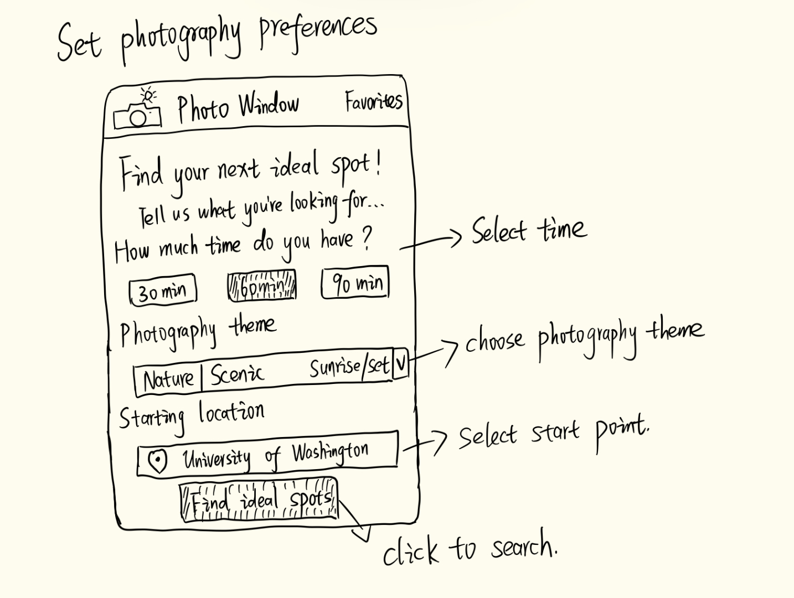
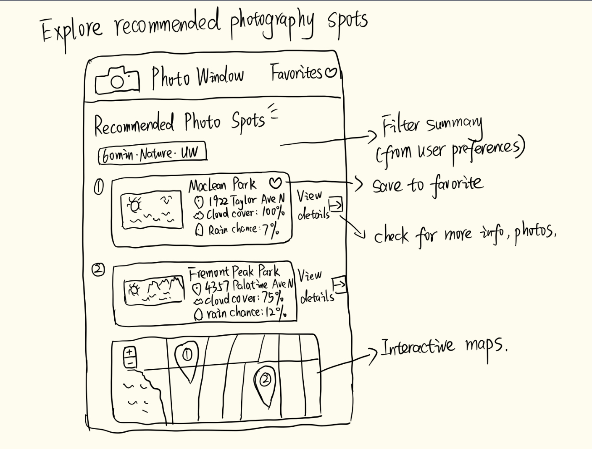
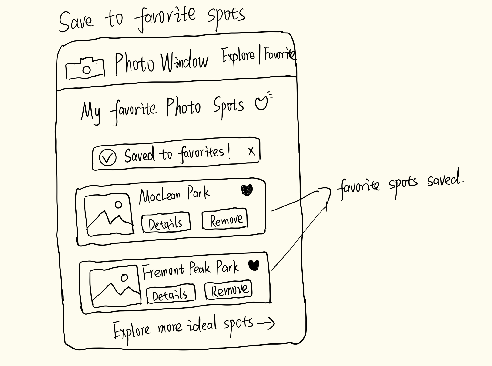

# Photo Window – P2 Proposal

**Course:** HCDE 310  
**Project:** Photo Window  
**Project Type:** Python Flask Web Application  
**Depth Item:** Made for a place

---

## 1. Design Problem, Audience, and Value

Photo Window is a location-based photography planning app designed for University of Washington students who enjoy taking photos around Seattle. These students may have only 30 to 90 minutes of free time between classes or on weekends and want to find scenic locations that match their interests and available time. Existing tools such as Google Maps and weather apps provide useful information separately, but students must compare multiple sources to decide where and when to take photos. Photo Window combines local viewpoint data, weather forecasts, and user preferences to recommend suitable photography locations. By bringing this information together, the app helps students spend less time planning and more time exploring and taking photos.

## 2. Depth Item: Made for a Place

Our selected depth item is **Made for a place** because Photo Window focuses on photography opportunities around Seattle and the University of Washington. The app will use an interactive Leaflet map to display local viewpoints and combine their geographic coordinates with weather information to provide location-based recommendations. Users will be able to identify recommended locations on the map and understand why each location fits their photography preferences.

The corresponding success criterion is included in Section 8.

## 3. Main User Flow

The main user flow consists of three actions:

1. Set photography preferences.
2. Explore recommended photography spots.
3. Save favorite photography spots.

### Action 1: Set Photography Preferences

The user opens Photo Window and enters their preferences, including available time, photography theme, and starting location.

| Step | The user... | The app... | They see |
|---|---|---|---|
| 1 | Opens Photo Window | Loads the photography preference form | A form with time, theme, and starting location options |
| 2 | Selects 60 minutes, scenic views, and UW Seattle as the starting location | Records and validates the selected preferences | Their selected preferences displayed in the form |
| 3 | Clicks "Find Spots" | Begins retrieving viewpoint and weather information | A loading message indicating that recommendations are being generated |

**Mockup 1: Photography Preferences**



**Special States:**

- **Loading:** "Finding photography spots near you..."
- **Empty:** "Select your photography preferences to get started."
- **Error:** "Please check your selections and try again."

### Action 2: Explore Recommended Photography Spots

Photo Window combines local viewpoint information with weather conditions and geographic proximity to recommend photography locations.

| Step | The user... | The app... | They see |
|---|---|---|---|
| 1 | Waits for the search results | Retrieves viewpoint and weather data from external sources | "Checking locations and weather..." |
| 2 | Reviews the recommendations | Filters and ranks locations based on preferences, weather, and proximity | A map with markers and recommendation cards |
| 3 | Selects a recommended location | Retrieves the selected location's details | Location name, weather information, map position, and recommendation explanation |

**Mockup 2: Photography Recommendations**



**Special States:**

- **Loading:** "Checking weather and photography locations..."
- **Empty:** "No locations match your preferences. Try changing your available time or photography theme."
- **Error:** "Unable to load recommendations. Please try again later."

**Recommendation Logic:**

The app will prioritize locations using three factors:

1. **Weather suitability:** Prefer locations with lower precipitation and weather conditions appropriate for the selected photography theme.
2. **Proximity:** Prefer locations closer to the selected starting point.
3. **Theme relevance:** Prefer viewpoints that match the user's selected photography interests.

The recommendation algorithm will run in Python rather than relying on an AI model.

For the initial version, available time will be used as a planning preference together with geographic proximity. Photo Window will not guarantee that a location can be reached within a specific number of minutes unless reliable travel-time data is available.

### Action 3: Save Favorite Photography Spots

After reviewing recommendations, the user can save locations they want to revisit.

| Step | The user... | The app... | They see |
|---|---|---|---|
| 1 | Selects a photography location | Displays the selected location's information | Location details and a Save button |
| 2 | Clicks "Save to Favorites" | Stores the location identifier and save timestamp in a JSON file | "Added to Favorites" confirmation |
| 3 | Opens the Favorites page | Reads saved locations from the JSON file | A list of previously saved photography spots |

**Mockup 3: Saved Photography Spots**



**Special States:**

- **Loading:** "Loading your saved photography spots..."
- **Empty:** "You haven't saved any photography spots yet."
- **Error:** "Unable to save this location. Please try again."

## 4. Data Sources

Photo Window will combine at least two external data sources to generate photography recommendations.

### Data Source 1: Seattle Parks Viewpoints Data

**Name:** Seattle Parks Viewpoints Dataset / Seattle Open Data

**Documentation:** https://data.seattle.gov/

**Purpose:**

This source will provide candidate viewpoint locations in Seattle. We intend to extract location names, geographic coordinates, and any available descriptions or location attributes.

**Used in:** Action 2, when retrieving and displaying candidate photography locations.

**API Key and Limits:**

TODO: Confirm the authentication requirements, rate limits, and exact endpoint for the selected dataset.

**Real API Call:**

TODO: Insert the verified dataset API URL and actual request parameters.

**Real API Response:**

TODO: Paste a trimmed response from an actual API request. Include only the fields used by the app.

**Fields We Intend to Use:**

- Location identifier
- Viewpoint name
- Latitude
- Longitude
- Description or other available attributes

**What We Noticed:**

TODO: Describe a real observation from the response, such as a missing field, unexpected format, or empty value.

**Potential Limitation:**

The dataset may not provide photography categories, accessibility information, or estimated travel times. If these fields are unavailable, we will avoid presenting them as verified information.

### Data Source 2: Open-Meteo Weather API

**Name:** Open-Meteo Weather Forecast API

**Documentation:** https://open-meteo.com/en/docs

**Purpose:**

Open-Meteo will provide weather information for candidate photography locations, including temperature, precipitation, cloud cover, and weather conditions.

**Used in:** Action 2, when evaluating weather suitability for photography.

**API Key and Limits:**

The standard Open-Meteo API offers access without an API key for eligible non-commercial use. We will check the applicable terms and request limits before implementation.

**Example API Call:**

```text
https://api.open-meteo.com/v1/forecast?latitude=47.60&longitude=-122.33&current=temperature_2m,precipitation,cloud_cover,weather_code&timezone=America%2FLos_Angeles
```

This request uses approximate Seattle coordinates. The actual application will use the coordinates of candidate photography locations.

**Real API Response:**

TODO: Run the request and paste the actual returned JSON fields.

**Fields Used:**

- `latitude`
- `longitude`
- `current.time`
- `current.temperature_2m`
- `current.precipitation`
- `current.cloud_cover`
- `current.weather_code`

**What We Noticed:**

TODO: Record a real observation about the returned data, units, timestamps, or missing values.

**Potential Limitation:**

Weather forecasts are estimates rather than guaranteed conditions. We will display the observation or forecast time and avoid claiming that the weather will definitely be suitable for photography.

### Combining the Data Sources

The application will use Python to combine geographic and weather information.

First, the viewpoint dataset provides a list of candidate photography locations and their coordinates. Next, Open-Meteo provides weather information for those coordinates. Python then applies the user's preferences to filter and rank the locations.

The combined result gives users information they would otherwise need to gather from multiple separate sources.

## 5. Data Model

Photo Window will manage four main types of data.

| Noun | Fields | Saved? Why? |
|---|---|---|
| PhotographySpot | `id`, `name`, `latitude`, `longitude`, `description`, `theme` | No. Loaded or normalized from viewpoint data |
| Weather | `latitude`, `longitude`, `time`, `temperature`, `precipitation`, `cloud_cover`, `weather_code` | No. Retrieved from the weather API |
| SearchPreference | `duration_minutes`, `theme`, `starting_location` | No. Used for the current search |
| Favorite | `spot_id`, `saved_at` | Yes. Stored in `favorites.json` so users can revisit saved locations |

### Data Relationships

- One search preference can produce multiple recommended photography spots.
- Each photography spot can be associated with weather information for its coordinates.
- Each favorite references one photography spot.
- Multiple favorites can be stored in the same JSON file.

### JSON Persistence

The application will store saved photography spots in `favorites.json`.

**Proposed JSON Structure:**

```json
{
  "favorites": [
    {
      "spot_id": "example-spot-id",
      "saved_at": "2026-11-22T15:00:00-08:00"
    }
  ]
}
```

This is an example of the planned data structure, not an actual saved record.

The application will read the file when users open Favorites and update it when users save or remove a location. This allows favorite locations to remain available between visits.

## 6. Tech Plan

Photo Window will use Python and Flask for application logic, HTML/CSS for the interface, and Leaflet JavaScript for the interactive map.

### Flask Routes

| Route | Receives | Calls | Shows |
|---|---|---|---|
| `/` | Nothing | None | Photography preference form |
| `/search` | Available time, photography theme, starting location | Viewpoint data and Open-Meteo | Recommended locations and map |
| `/spot/<spot_id>` | Photography spot identifier | Normalized location data | Location details |
| `/favorites` | Nothing | Local JSON storage | Saved photography spots |
| `/favorites/add` | Photography spot identifier | JSON storage function | Save confirmation |
| `/favorites/remove` | Photography spot identifier | JSON storage function | Updated favorites |

### File Responsibilities

| File | Responsibility |
|---|---|
| `app.py` | Defines Flask routes and coordinates application behavior |
| `parks.py` | Retrieves and processes Seattle viewpoint data |
| `weather.py` | Requests and parses Open-Meteo weather information |
| `recommend.py` | Filters and ranks photography locations |
| `storage.py` | Reads and writes JSON favorites |
| `favorites.json` | Stores saved photography locations |
| `templates/index.html` | Displays the photography preference form |
| `templates/results.html` | Displays recommendations and map |
| `templates/favorites.html` | Displays saved photography spots |
| `static/style.css` | Controls visual styling and responsive layout |
| `static/map.js` | Displays the Leaflet map and location markers |
| `requirements.txt` | Lists required Python packages |
| `.env.example` | Documents environment variable names without secret values |
| `README.md` | Explains installation and how to run the application |

### Application Logic

1. Flask receives the user's photography preferences.
2. Python retrieves or loads Seattle viewpoint data.
3. Python requests weather information from Open-Meteo.
4. The recommendation module filters and ranks locations.
5. Flask sends the recommended locations to the results page.
6. Leaflet displays the locations as markers on an interactive map.
7. Users can save selected locations to `favorites.json`.

### Accessibility Plan

We will check three accessibility requirements:

1. **Keyboard navigation:** Users can operate forms, buttons, and favorites without a mouse.
2. **Form labels and feedback:** Inputs have visible labels, and error messages explain what needs to be corrected.
3. **Color contrast and text alternatives:** Text has readable contrast, and location information is available in text cards rather than only through map markers.

### Running the Application

The project will run locally using Flask. A user outside our team should be able to clone the repository, install the packages listed in `requirements.txt`, configure any required environment variables using `.env.example`, and follow the instructions in `README.md`.

## 7. User Testing

We plan to test Photo Window with three University of Washington students who are interested in photography or exploring Seattle.

| Participant | Role | Recruitment | Planned Test Date |
|---|---|---|---|
| Participant 1 | UW student interested in casual photography | TODO: Confirm recruitment method | TODO: Confirm date |
| Participant 2 | UW student who enjoys exploring Seattle | TODO: Confirm recruitment method | TODO: Confirm date |
| Participant 3 | UW student who takes scenic photos on weekends | TODO: Confirm recruitment method | TODO: Confirm date |

### Testing Procedure

Each participant will complete three tasks:

1. Enter photography preferences and search for locations.
2. Explore the recommended spots and identify one they would consider visiting.
3. Save a location and find it again in Favorites.

We will observe whether participants understand the interface, can complete tasks independently, and find the recommendations useful.

We will also ask participants to explain why they selected a particular location and whether the displayed information helped them make a decision.

## 8. Success Criteria

### Code Success Criteria

1. **Recommendation functionality:** Given valid preferences and available API data, Photo Window displays at least one relevant photography location with a corresponding map marker when matching locations exist.
2. **Error handling:** If an external API request fails or returns no usable results, the application displays an appropriate error or empty state without crashing.
3. **JSON persistence:** After a user saves a location, the favorite remains available after the Flask application is restarted.

### People Success Criteria

1. At least 2 out of 3 participants can find a photography location they would consider visiting within three minutes without assistance.
2. At least 2 out of 3 participants can correctly explain why a recommended location fits their preferences.
3. All 3 participants can save a photography location and reopen it from Favorites without assistance.

### Depth Item Success Criterion

At least 2 out of 3 participants can identify their selected photography location on the interactive map and explain how its location influenced their decision.

## 9. Priorities and Risks

### Must-Have Features

- Photography preference form
- At least two functioning external data sources
- Python-based location recommendation logic
- Interactive Leaflet map
- Photography location details
- JSON-based favorites
- Loading, empty, and error states
- Basic accessibility support
- Clear README instructions

### Nice-to-Have Features

Listed in priority order:

1. Additional photography themes and filters
2. More detailed weather-based recommendation explanations
3. Estimated travel times using an additional reliable data source
4. Expanded photography locations beyond viewpoints
5. More advanced visual styling and animations

### Risks

**Risk 1: Incomplete or inaccessible viewpoint data**

The Seattle viewpoint dataset may have missing coordinates, limited descriptions, or an unavailable endpoint.

**Early Test:** Retrieve a real response from the selected dataset and check whether the necessary fields are present. If the dataset is insufficient, investigate an alternative documented location dataset before implementing the recommendation system.

**Risk 2: Inaccurate time-based recommendations**

Geographic distance alone does not provide reliable travel-time estimates.

**Early Test:** Compare a small sample of candidate locations and evaluate whether the proposed proximity-based filtering is reasonable. If reliable travel times are unavailable, label recommendations as proximity-based rather than guaranteeing arrival within the selected time.

## 10. AI Plan

We plan to use AI as a development assistant after defining our project requirements, user flow, and success criteria ourselves. AI may help explain API documentation, suggest Python implementation approaches, review Flask routes, and identify potential bugs or missing edge cases.

We will check AI-generated code by reviewing its logic, comparing outputs with real API responses, and testing the success criteria listed in Section 8. We will also test loading, empty, and error states rather than assuming generated code works correctly.

We will not delegate final decisions about our target audience, user experience, or recommendation criteria to AI because these decisions should reflect our own design goals and feedback from real users. All AI interactions and generated contributions will be documented in `P2/ai_use.md`.

## 11. Pair Responsibilities

| Team Member | Responsibilities | Files |
|---|---|---|
| TODO: Team member 1 | TODO: Confirm responsibilities | TODO: Confirm files |
| TODO: Team member 2 | TODO: Confirm responsibilities | TODO: Confirm files |

Both team members will review the proposal, verify the API responses, and evaluate the completed user flow.

To avoid editing conflicts, each team member will work primarily on their assigned files. Changes affecting shared functionality will be reviewed together before merging or committing.

---

## References

- [Seattle Open Data](https://data.seattle.gov/)
- [Open-Meteo Weather Forecast API](https://open-meteo.com/en/docs)
- [Leaflet Documentation](https://leafletjs.com/reference.html)
- [Flask Documentation](https://flask.palletsprojects.com/)

